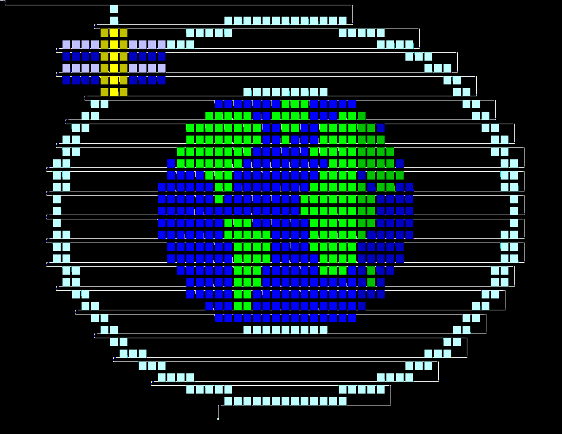

# SkyForge Piet

**Satellite tracking computed by executable images.** The PNG files are Piet
programs: an unmodified interpreter reads their colors, traverses their blocks,
and performs the mathematics on its stack.



The image above computes circular-orbit speed. Every colored block is visited;
the calculation is distributed through the Earth, ring, and satellite.

The larger [tracking engine PNG](tracking/tracking.png) computes:

**Orbital elements + elapsed time + station → ECI position/velocity → azimuth,
elevation, range, range rate, Doppler, and visibility.**

This is an elliptic **two-body** model with rotating spherical Earth.
The stable baseline is [v0.2.0](https://github.com/Hermestheog/skyforge-piet/releases/tag/v0.2.0).

**SGP4 development has started:** a separate [SGP4 epoch PNG](sgp4/epoch.png)
computes bounded near-Earth TEME states at the TLE epoch, including WGS-72
un-Kozai initialization and long/short-period corrections. It passes nine
published epoch vectors and additional numerical/input tests. It does **not**
yet propagate to other times or implement drag or deep-space dynamics.
See [SGP4 instructions and limits](sgp4/README.md) and the [roadmap](docs/ROADMAP.md).

## Run the PNGs

Build the included, unmodified npiet 1.3h with PNG support:

```sh
docker build -t skyforge-piet .
```

Linux/macOS, from the repository directory:

```sh
# Circular speed: radius 42164 km → 3074 m/s.
printf '42164\n' | docker run --rm -i --network none -v "$PWD:/work:ro" skyforge-piet -q -cs 1 skyforge-orbit.png

# Full tracking example: equatorial satellite directly above the station.
docker run --rm -i --network none -v "$PWD:/work:ro" skyforge-piet -q -cs 1 tracking/tracking.png < examples/equatorial-zenith.txt
```

PowerShell:

```powershell
$pietDir = (Get-Location).Path
Get-Content examples/equatorial-zenith.txt | docker run --rm -i --network none --mount "type=bind,source=$pietDir,target=/work,readonly" skyforge-piet -q -cs 1 tracking/tracking.png
```

With a suitable native **64-bit npiet** installation, the equivalent command is
`npiet -q -cs 1 tracking/tracking.png < examples/equatorial-zenith.txt`.
The original circular-speed image also supports 32-bit arithmetic.

The tracking example returns:

```
0 7000000 0 0 0 7546049 0 -1 90000 621863 0 0 1
```

Fields: status, ECI x/y/z (m), ECI vx/vy/vz (mm/s), azimuth/elevation (millidegrees),
range (m), range rate (mm/s), Doppler shift (Hz), visibility. `-1` azimuth means
undefined at zenith/nadir. The elevation value 90000 represents 90°.

## Tracking input

Provide twelve whitespace-separated decimal integers:

| Field | Unit / allowed range |
|---|---|
| Semimajor axis | km, 6478–50000 |
| Eccentricity | parts per million, 0–500000 |
| Inclination | millidegrees, 0–180000 |
| RAAN | millidegrees, 0–360000 |
| Argument of periapsis | millidegrees, 0–360000 |
| Mean anomaly at epoch | millidegrees, 0–360000 |
| Time since epoch | seconds, -86400–86400 |
| Earth rotation angle at epoch | millidegrees, 0–360000 |
| Station latitude | millidegrees, -90000–90000 |
| Station longitude | millidegrees, -180000–180000 |
| Station altitude | metres, 0–10000 |
| Carrier frequency | **kHz**, 0–10000000 (up to 10 GHz) |

Perigee must be at least 6478 km. Invalid bounds, missing input, or a token that
npiet cannot read as an integer produce `1` followed by twelve zeros. Inputs must fit signed 32-bit;
do not pass oversized integer strings to npiet's C input parser. Extra input
after the twelve fields is ignored.
The interpreter uses C integer parsing: a numeric prefix can be accepted before
trailing nonnumeric text, especially in the final field. Supply integer tokens.

Positive range rate means receding; positive Doppler means approaching. Latitude
and longitude are spherical/geocentric station coordinates in this model.

## What runs where

- **PNG:** all input handling, Kepler solving, square roots, trig, frame rotations,
  observer geometry, Doppler, and output execute as ordinary Piet instructions.
- **Assembler:** JavaScript emits colors and control flow. It never reads orbital
  inputs or evaluates an orbit. `tracking/program.pietasm` is its auditable listing.
- **Tests:** a separate floating-point implementation supplies expected results.
  It is not part of runtime execution and cannot supply answers to the PNG.

The tracking PNG contains approximately 89,000 emitted instructions, plus layout
routing and twelve real error branches. The original Earth artwork is preserved
as its own program, with its original test file unchanged. The tracker currently
uses a compact raster layout rather than that illustration.

See [numerics and interpreter constraints](docs/TRACKING.md), including the
npiet `roll` limitation discovered during development.

## Verify and rebuild

```sh
# All tests run sequentially; no npm packages are needed.
docker run --rm --network none -v "$PWD:/work" --entrypoint npm skyforge-piet test

# Rebuild and verify that every executable pixel is identical.
docker run --rm -v "$PWD:/work" --entrypoint node skyforge-piet scripts/rebuild-check.mjs
```

Use the same PowerShell `--mount` form above instead of `-v "$PWD:/work"`.
With Node 22+ and npiet on PATH, use `npm test` and `npm run build` directly.

Evidence is checked in: [circular tests](TEST-RESULTS.md), [574 before/after
comparisons](equivalence-results.json), [artwork coverage](layout-verification.json),
and [tracking results](tracking/test-results.json), plus the
[SGP4 epoch comparisons](sgp4/test-results.json). Tests retain strict timeouts
and execute actual PNG files in unmodified npiet.

## Development history

The [development log](docs/DEVELOPMENT-LOG.md) preserves bugs, failed hypotheses,
interpreter quirks, fixes, and validation results. Selected full traces are
compressed under `logs/`. `npm test` saves all suite output in timestamped
`logs/runs/` directories, including failures. GitHub Actions also uploads test
evidence for 90 days; notable findings belong in the permanent development log.

## License

Project code and PNG programs: [MIT](LICENSE). The separately vendored
[npiet interpreter](https://www.bertnase.de/npiet/) retains its original
[GPL-2.0 license](vendor/COPYING). See [circular-program documentation](CIRCULAR.md)
for interpreter provenance and the original challenge.
The independent SGP4 test oracle and verification fixtures retain their
upstream [Unlicense](vendor/sgp4-reference/LICENSE), with pinned
[provenance](vendor/sgp4-reference/provenance.json).
